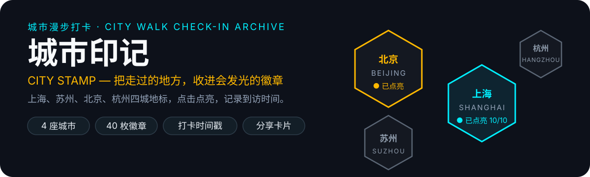
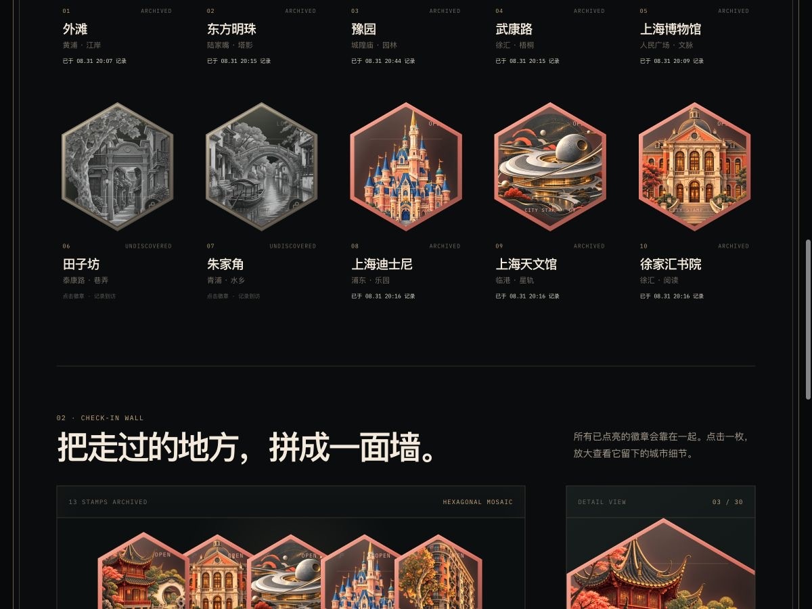

<p align="right"><a href="README.md">中文</a></p>

<p align="center">
  
</p>

<p align="center">
  <a href="https://xiaosang.cc/city-stamp/">▶ Play Online</a>
  ·
  <a href="https://github.com/holynova/city-stamp">GitHub Repository</a>
</p>

City Stamp is a city-walk check-in archive: 40 hexagonal metal badges for 10 landmarks in each of Shanghai, Suzhou, Beijing and Hangzhou. Unlit badges are deep grayscale with a matte metal finish; tapping one lights it up with a neon glow and records the check-in time. Progress is saved in the browser, and your lit badges can be shared as a card or assembled into a check-in wall.

## Screenshot

<p align="center">
  
</p>

## How It Works

- **Light up to check in**: tap a badge to light it and record the visit time; tap again to undo. Check-in records live in the browser's localStorage and survive refreshes.
- **3D parallax**: badges tilt with the pointer across multiple layers, showing metal depth and thickness; tap one to view a full-screen 3D close-up.
- **Check-in wall**: all lit badges form a honeycomb mosaic wall, zoomable and pannable from 75% to 160%, showing your progress across all four cities at a glance.
- **Check-in journal**: all check-ins listed newest-first; tap one to jump back to its badge.
- **Share card**: generate a shareable card image with your unlocked badge array, per-city completion rates and check-in dates.
- **Reset archive**: clear all check-in records (with a confirmation step).

## Collection

4 cities, 10 badges each:

| City | Landmarks |
|---|---|
| 上海 Shanghai | 外滩 The Bund, 东方明珠 Oriental Pearl Tower, 豫园 Yu Garden, 武康路 Wukang Road, 上海博物馆 Shanghai Museum, 田子坊 Tianzifang, 朱家角 Zhujiajiao, 上海迪士尼 Shanghai Disney Resort, 上海天文馆 Shanghai Astronomy Museum, 徐家汇书院 Xujiahui Library |
| 苏州 Suzhou | 拙政园 Humble Administrator's Garden, 狮子林 Lion Grove Garden, 平江路 Pingjiang Road, 山塘街 Shantang Street, 寒山寺 Hanshan Temple, 苏州博物馆 Suzhou Museum, 留园 Lingering Garden, 诚品书店 Eslite Bookstore, 同里古镇 Tongli Ancient Town, 金鸡湖 Jinji Lake |
| 北京 Beijing | 故宫 Forbidden City, 天安门广场 Tiananmen Square, 八达岭长城 Badaling Great Wall, 颐和园 Summer Palace, 天坛 Temple of Heaven, 798 艺术区 798 Art Zone, 胡同漫游 Hutong Stroll, 国家大剧院 National Centre for the Performing Arts, 雍和宫 Lama Temple, 景山公园 Jingshan Park |
| 杭州 Hangzhou | 西湖 West Lake, 灵隐寺 Lingyin Temple, 雷峰塔 Leifeng Pagoda, 断桥残雪 Broken Bridge, 西溪湿地 Xixi Wetland, 京杭大运河 Beijing–Hangzhou Grand Canal, 六和塔 Six Harmonies Pagoda, 河坊街 Hefang Street, 龙井村 Longjing Village, 良渚古城遗址公园 Liangzhu Ancient City Ruins Park |

## Run Locally

```bash
npm install
npm run dev      # Development server
npm run build    # Production build
```

## Tech

- Vite 6 + React 19, Phosphor icons, IBM Plex Sans / Mono fonts.
- Badge artwork ships in both PNG and WebP under `public/badges/` and `public/badges-webp/`, 40 badges in total.
- Check-in state persists in localStorage; share cards are drawn and exported with Canvas.

```
index.html              Entry
src/App.jsx             All UI and logic: badge list, check-in wall, journal, share card
src/styles.css          Dark archive-style styling
src/main.jsx            React entry
public/badges/          40 badge PNG originals
public/badges-webp/     40 badge WebP images
scripts/prepare-sites-build.mjs   Post-build processing
tests/sites-worker.test.mjs       Site tests (node --test)
```
